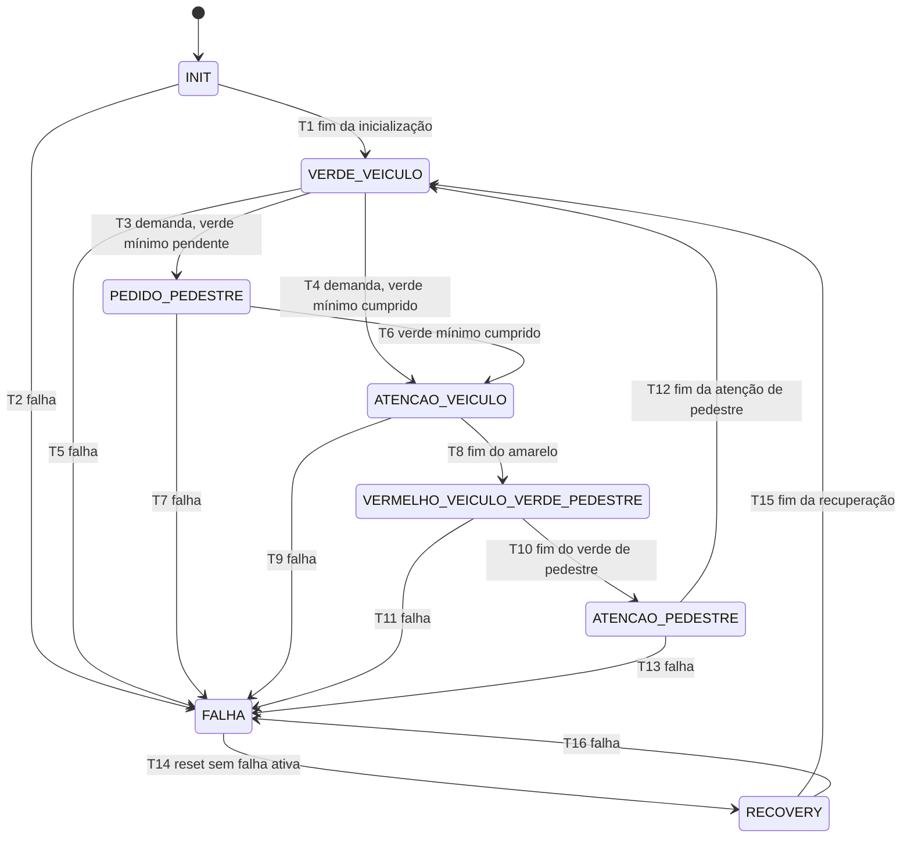

<p align="center"></p>

# PTT7 — Semáforo com travessia de pedestres baseado em FSM no ESP32, com verificação em duas camadas

Produto técnico-tecnológico da trilha **PTT7 (Controle baseado em FSM)**, disciplina Arquitetura e
Organização de Computadores, Mestrado Profissional em Computação Aplicada (PPCA/UFRR), 2026.2.
Discentes: Pedro Vinicius da Silva Ribeiro e Matheus Naranjo Corrêa. Orientador: Prof. Herbert Rocha.

> **Para executar e testar, siga o [MANUAL_EXECUCAO.md](MANUAL_EXECUCAO.md).**

## Visão geral

```
            spec/transition_table.csv  (especificação comum: 8 estados, T1..T16)
                 │                    │                       │
     core/fsm_core.c  ◄── mesmo arquivo ──►  firmware/ (ESP-IDF: GPIO, ISR, FreeRTOS)
        │        │                          
  ESBMC (código) │  conformidade (mesmos vetores)  ◄──►  modelo Z3 API C++ (verification/z3)
                 │
           sim/ (Plano B: host)
```

- **Núcleo** (`core/`): função de transição e de saída em C99 puro, sem hardware, com o tempo
  decorrido como entrada explícita (`dt_ms`) e temporizadores saturados.
- **Camada 1** (`verification/z3/`): modelo abstrato escrito a partir da tabela, consultado pelo Z3 via API C++.
- **Camada 2** (`verification/esbmc/`): ESBMC (backend Z3) sobre o mesmo `fsm_core.c` do firmware.
- **Firmware** (`firmware/`): ESP-IDF v5.1, ISR em IRAM, notificação de tarefa, núcleo em IRAM,
  instrumentação `esp_timer_get_time()` e console de experimentos (latência e injeção de falhas).

## Máquina de estados

Diagrama gerado a partir de [`spec/transition_table.csv`](spec/transition_table.csv), a especificação comum
usada pelo núcleo, pelo modelo Z3 e pelo firmware.



## Reprodução rápida (host, sem placa)

```bash
python -m pip install -r requirements.txt
python3 tools/ptt7.py all          # build + testes + Z3 + ESBMC + CVF
```

## Ferramentas e versões usadas no desenvolvimento

| Ferramenta | Versão |
|---|---|
| ESP-IDF | v5.1.4 (alvo esp32, xtensa-esp32-elf 12.2.0) |
| Z3 (API C++, via pacote `z3-solver`) | 5.1.0 |
| ESBMC | 8.5.0 (backend Z3 4.13.3) |
| GCC / G++ (host) | 12+ |
| Python | 3.10+ |

Registre as versões do seu ambiente com `python3 tools/ptt7.py versions` (gera `verification/results/versoes.txt`).

## Parâmetros, premissas e limites de exploração

- Temporizações (`core/fsm_config.h`): INIT 2 s · verde mínimo 8 s · amarelo 3 s · verde de pedestre 6 s ·
  atenção de pedestre 3 s · recovery 3 s · **DT_MAX 200 ms** (atraso maior = falha de temporização).
- Falha = perda de sinal do botão 1 **ou** do botão 2 (supervisão de linha) **ou** `dt_ms > DT_MAX`.
- Premissas A1–A7 e decisões sobre os limites: [`docs/registro_verificacao.md`](docs/registro_verificacao.md).
- Horizontes: BMC k=10 para P5 (protocolo); k_ciclo=133 para alcançabilidade no Z3; alcançabilidade
  composicional em 8 segmentos (≤ 41 passos) no ESBMC; provas de 1 passo e k-indução para resultados ilimitados.

## Resultados atuais da verificação (06/10/2026, reconfirmados em 21/11/2026 com ESBMC 8.5.0)

| Propriedade | Modelo (Z3) | Código (ESBMC) |
|---|---|---|
| P1 alcançabilidade | comprovado | comprovado |
| P2 ausência de deadlock | comprovado | comprovado |
| P3 exclusão mútua (+ verde mínimo) | comprovado | comprovado |
| P4 violação → estado seguro | comprovado | comprovado |
| P5 convergência do fallback | comprovado (indutivo + BMC k=10) | comprovado (k-indução) |
| P6 FALHA não retorna direto a VP | comprovado | comprovado |

Testes negativos com o mutante `-DFSM_INJECT_BUG` refutam P6 nas duas camadas. Um *overflow*
aritmético encontrado pelo ESBMC foi corrigido (achado ESBMC-01). Os resultados de bancada (Q2 latência,
Q3 fallback) foram coletados em 24/11/2026 no ESP32 físico, com falhas injetadas por software
(`PTT7_SUPERVISAO_HW = 0`):

- **Q3 (fallback):** 200/200 injeções (50 por tipo) convergiram a FALHA em até 1 s, sem retorno ao
  verde; recuperação via reset 200/200. Protocolo atendido.
- **Q2 (LREC):** respondida de forma **exploratória**; o protocolo **não foi atendido** (0 medições
  válidas de T4, 1 sessão). Como ordem de grandeza, 23 registros reais deram LREC mediano de
  cerca de 14 µs (ISR → GPIO). Não há latência fim a fim física nem p99.

Detalhes, causas e reteste: [`docs/validacao/evidencias/resultados_bancada_2026-11-24.md`](docs/validacao/evidencias/resultados_bancada_2026-11-24.md).

Validação e alinhamento: [`docs/validacao/`](docs/validacao/) (matriz de rastreabilidade T1–T16 e P1–P6,
divergências entre o núcleo verificado e a simulação Wokwi). Materiais de entrega: [`docs/entrega/`](docs/entrega/).

> Use o **ESBMC 8.5.0**. Com o 8.7.0 a consulta `kind-P5` fica inconclusiva (ver `docs/registro_verificacao.md`).

## Estrutura

```
core/            núcleo da FSM (fsm_core.c/.h, fsm_config.h)
spec/            tabela de transições e especificação (OE1)
tests/           testes unitários do núcleo
sim/             simulador de host (Plano B) e cenários de aceitação
verification/    z3/ (modelo + conformidade), esbmc/ (harnesses), results/ (saídas)
firmware/        projeto ESP-IDF
tools/           ptt7.py (orquestrador), capture_serial.py
analysis/        analyze.py (Q2/Q3), cvf.py (Q1)
data/            raw/ (logs brutos), descartes.csv
docs/            bancada.md, registro_verificacao.md
```

## Licença

MIT — ver [LICENSE](LICENSE).
