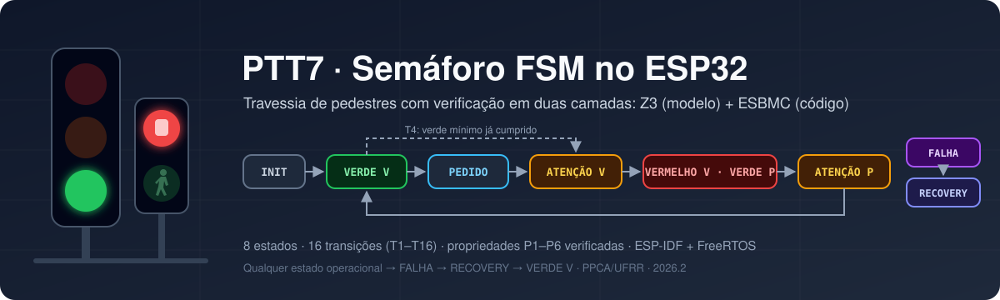
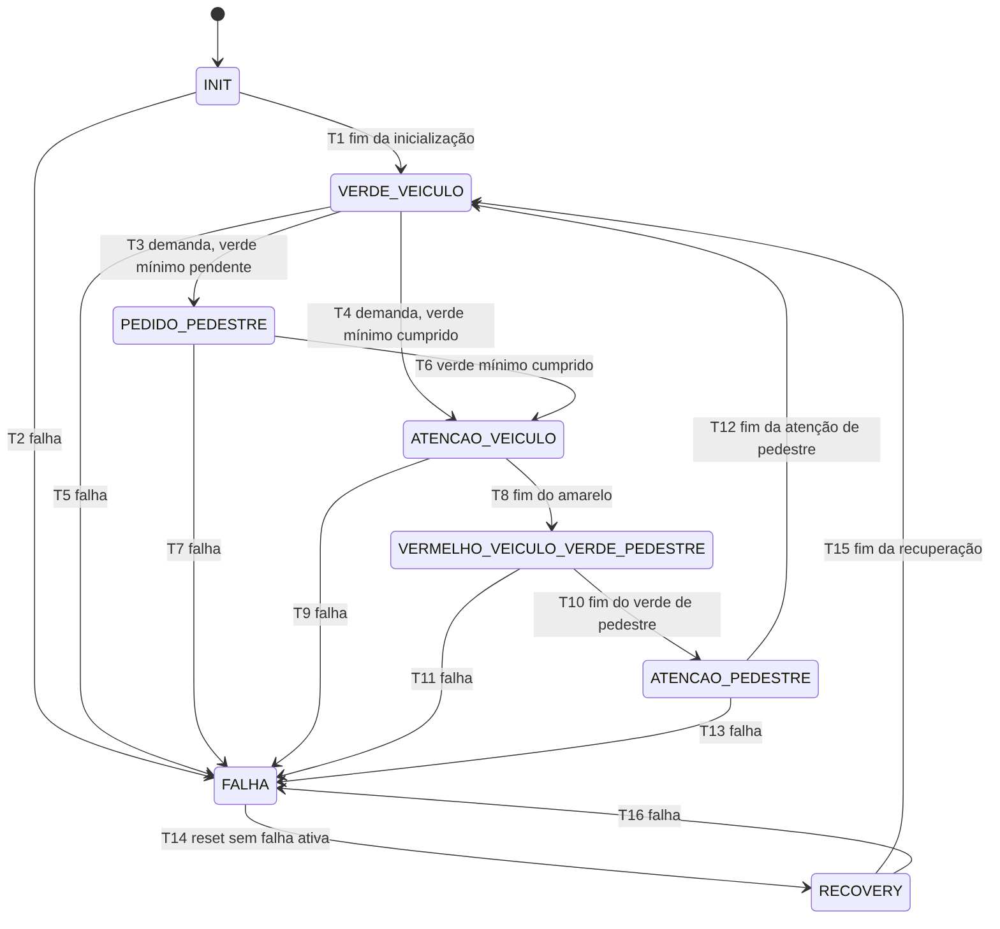

<p align="center"></p>

# PTT7 — Semáforo com travessia de pedestres baseado em FSM no ESP32, com verificação em duas camadas

Produto técnico-tecnológico da trilha **PTT7 (Controle baseado em FSM)** · Arquitetura e Organização de
Computadores · Mestrado Profissional em Computação Aplicada (PPCA/UFRR), 2026.2.
**Discentes:** Matheus Naranjo Corrêa e Pedro Vinicius da Silva Ribeiro · **Orientador:** Prof. Herbert Rocha.

📄 [Relatório técnico (PDF)](docs/entrega/final/relatorio_tecnico.pdf) ·
🛠️ [Manual de execução](MANUAL_EXECUCAO.md) ·
📑 [Contrato assinado](docs/entrega/contrato/projeto_pesquisa_ptt7_assinado.pdf) ·
🎥 [Vídeos de execução](https://drive.google.com/drive/folders/1w-mvAM3hBnI3b9LSmzt6A5wP4t3ufybH?usp=sharing)

## Proposta

Em um semáforo, um erro de lógica pode dar verde a carros e pedestres ao mesmo tempo. A proposta é um
controlador de semáforo com travessia de pedestres modelado como **máquina de estados finitos (8 estados,
16 transições)**, executado no ESP32, cuja lógica é **verificada em duas camadas** e avaliada em bancada.
O trabalho responde a três perguntas:

- **Q1:** o modelo abstrato e o código C concordam nas propriedades de segurança e vivacidade (P1–P6)?
- **Q2:** qual é a latência entre a interrupção do botão de pedestre e o comando de transição?
- **Q3:** sob falhas injetadas, o sistema converge ao estado seguro (amarelo piscante), e com que taxa e tempo?

<p align="center"></p>

## Desenvolvimento

```
        spec/transition_table.csv  (especificação comum: 8 estados, T1..T16)
                 │
     core/fsm_core.c  ◄── mesmo arquivo ──►  firmware/ (ESP-IDF: GPIO, ISR, FreeRTOS)
        │
  ESBMC (código)   ◄── mesmos vetores ──►  modelo Z3 (verification/z3)
```

1. **Especificação** (`spec/`): tabela de transições única, usada pelo núcleo, pelo modelo e pelo firmware.
2. **Núcleo** (`core/`): função de transição em C99 puro, sem hardware, com o tempo como entrada (`dt_ms`).
3. **Verificação em duas camadas** (`verification/`): **Z3** sobre um modelo abstrato da FSM (camada 1) e
   **ESBMC 8.5.0** sobre o próprio `fsm_core.c` que vai para a placa (camada 2), com teste de mutante.
4. **Firmware** (`firmware/`): ESP-IDF v5.1.4, ISR e núcleo em IRAM, tarefa FreeRTOS de 10 ms,
   instrumentação com `esp_timer_get_time()` e console para os experimentos de latência e falhas.
5. **Bancada** (`data/`, `analysis/`): logs seriais brutos e análise estatística reprodutível.

Reprodução rápida no computador, sem placa (o passo a passo completo está no [manual](MANUAL_EXECUCAO.md)):

```bash
git clone https://github.com/MatheusOrange211/ptt7-semaforo-fsm.git
cd ptt7-semaforo-fsm
python -m pip install -r requirements.txt
python3 tools/ptt7.py all     # build + testes + Z3 + ESBMC + CVF
```

## Organização do repositório

```
spec/            especificação da FSM e tabela de transições
core/            núcleo verificado (fsm_core.c/.h, fsm_config.h)
firmware/        projeto ESP-IDF para o ESP32
tests/           testes do núcleo no computador
verification/    z3/ (modelo), esbmc/ (harnesses), results/ (saídas e versões)
sim/             simulador de host (Plano B) e cenários de falha
data/raw/        logs brutos da bancada (Q2 e Q3)
analysis/        analyze.py (Q2/Q3) e cvf.py (Q1)
tools/           ptt7.py (comando único) e capture_serial.py
docs/            bancada, registro da verificação, validação/evidências e entrega/
simulação/       demo no Wokwi (didática, com núcleo próprio; não é evidência)
```

## Resultados esperados × alcançados

| Pergunta / entregável | Esperado (contrato) | Alcançado | Situação |
|---|---|---|---|
| **Q1** concordância modelo × código | P1–P6 com resultado consistente no Z3 e no ESBMC | 6/6 propriedades comprovadas nas duas camadas; mutante detectado por ambas; ESBMC achou um *overflow* que o modelo não via (ESBMC-01, corrigido) | ✅ |
| **Q2** latência ISR → GPIO | ≥ 30 medições válidas da T4 em ≥ 3 sessões | 30 medições válidas, todas com **20 µs** (≈ 500× menor que o período de 10 ms), mas num único *boot* e com 1 rótulo de sessão | ◐ parcial |
| **Q3** convergência ao estado seguro | ≥ 50 injeções por tipo; estado seguro em até 1 s | **200/200** injeções no estado seguro em até 1 s (mediana 4,4–5,4 ms nos tipos 1–3), nenhum retorno ao verde; recuperação por *reset* 200/200 | ✅ |
| Repositório, README, dados brutos, scripts | versionados e reprodutíveis | este repositório, com logs brutos, SHA-256 e versões registradas | ✅ |
| Relatório técnico conclusivo | resultados, contraexemplos, limitações | [`relatorio_tecnico.pdf`](docs/entrega/final/relatorio_tecnico.pdf) | ✅ |
| Vídeo de demonstração (3–5 min) | operação normal, travessia e recuperação | roteiro em [`roteiro_video.md`](docs/entrega/final/roteiro_video.md); vídeos de execução da bancada [no Drive](https://drive.google.com/drive/folders/1w-mvAM3hBnI3b9LSmzt6A5wP4t3ufybH?usp=sharing) | ⏳ |

**Limites principais:** as falhas foram injetadas por software (pinos de supervisão GPIO22/23 não
exercitados); a latência medida é interna (ISR → GPIO), sem medição física de ponta a ponta nem p99.
Detalhes nas evidências de [24/11](docs/validacao/evidencias/resultados_bancada_2026-11-24.md) e do
[reteste de 26/11](docs/validacao/evidencias/resultados_reteste_q2_2026-11-26.md), e na
[matriz de rastreabilidade](docs/validacao/matriz_rastreabilidade.md).

## Trabalhos futuros

- Repetir a Q2 em 3 sessões independentes (com `sessao N`, reinício da placa e *banner*), variando a fase
  do estímulo em relação ao *tick* do FreeRTOS para explorar o pior caso.
- Medir a latência física do botão ao LED com analisador lógico.
- Exercitar a supervisão por *hardware* (`PTT7_SUPERVISAO_HW = 1`) e as transições ainda sem registro na placa.
- Consolidar o processo de verificação em artigo para evento de sistemas embarcados e publicar os dados
  com identificador persistente (contrato, item 10.2).

## Licença

MIT — ver [LICENSE](LICENSE).
