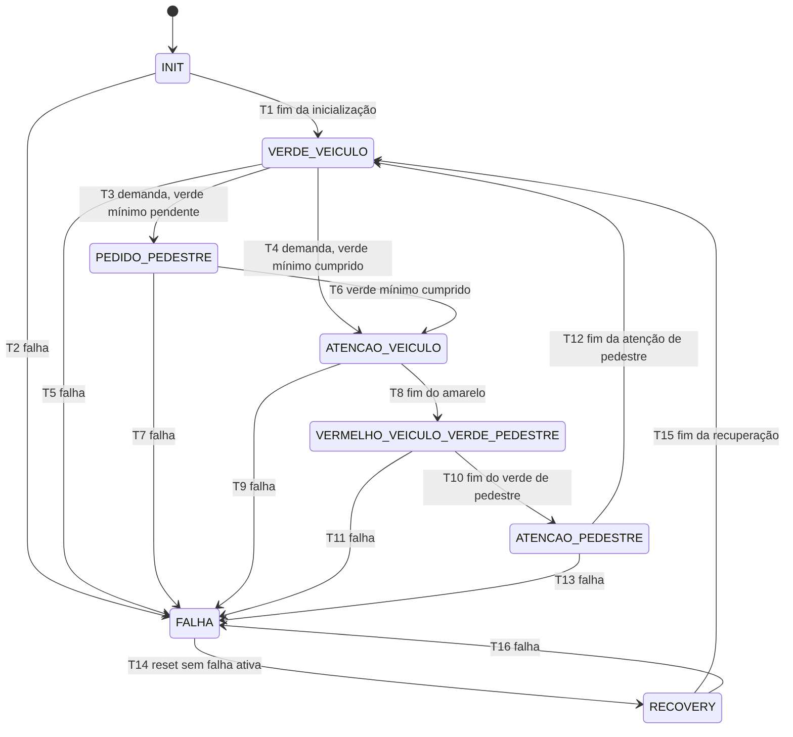

# Verificação em duas camadas de um controlador de semáforo com travessia de pedestres baseado em máquina de estados finitos no ESP32

**Matheus Naranjo Corrêa¹ · Pedro Vinicius da Silva Ribeiro¹**

Orientador: Prof. Herbert Rocha¹

¹ Programa de Pós-Graduação em Computação Aplicada (PPCA), Universidade Federal de Roraima (UFRR).
Disciplina Arquitetura e Organização de Computadores · 2026.2 · Relatório técnico conclusivo da
trilha PTT7 (produto secundário).

> **Estado desta versão (25/11/2026).** Os resultados de verificação (Q1) e de injeção de falhas
> (Q3) são finais. A medição de latência (Q2) obtida em 24/11/2026 **não atendeu ao protocolo**.
> O reteste, com o procedimento corrigido da Seção 6.4, está em execução. Quando terminar, as
> Seções 7.4, 9 e o Apêndice A serão atualizados com os novos números, e os logs brutos ficarão em
> `data/raw/`.

---

## Resumo

Em um semáforo, um erro de lógica pode autorizar verde simultâneo para veículos e pedestres. Este
trabalho apresenta um controlador de semáforo com travessia de pedestres modelado como máquina de
estados finitos (FSM) de 8 estados e 16 transições, implementado no ESP32 com o núcleo lógico
isolado em um único arquivo C, sem acesso a hardware. Seis propriedades de segurança e vivacidade
(P1–P6) foram verificadas em duas camadas: um modelo abstrato da FSM, consultado com o solucionador
SMT Z3, e o próprio código C, analisado com o verificador de modelos limitado ESBMC. As seis
propriedades foram comprovadas nas duas camadas, e um mutante com defeito proposital foi detectado
por ambas. A camada de código encontrou um *overflow* aritmético que o modelo, por usar inteiros
ilimitados, não poderia revelar. Em bancada física, 200 falhas injetadas por software (50 por tipo)
levaram o sistema ao estado seguro em até 1 s, sem nenhum retorno ao verde, e a recuperação por
*reset* funcionou nos 200 casos. A medição de latência entre a interrupção do botão e a
atualização dos LEDs não atingiu o número mínimo de medições do protocolo na primeira sessão; os
23 registros disponíveis indicam, apenas como ordem de grandeza, mediana de 14 µs.

**Palavras-chave:** máquina de estados finitos; verificação de modelos; ESBMC; Z3; ESP32;
injeção de falhas.

## Abstract

A logic error in a traffic light can authorize green for vehicles and pedestrians at the same time.
This work presents a pedestrian-crossing traffic light controller modeled as a finite state machine
(8 states, 16 transitions) on the ESP32, whose logic core is a single hardware-free C file. Six
safety and liveness properties were verified in two layers: an abstract model checked with the Z3
SMT solver and the C code itself checked with the ESBMC bounded model checker. All six properties
were proved in both layers, and a deliberately faulty mutant was detected by both. The code layer
found an arithmetic overflow that the unbounded-integer model could not reveal. On the physical
bench, 200 software-injected faults led the system to the safe state within 1 s with no return to
green. The interrupt-to-output latency protocol was not met in the first session; the 23 available
samples suggest a median of 14 µs as an order of magnitude only.

**Keywords:** finite state machine; model checking; ESBMC; Z3; ESP32; fault injection.

---

## 1. Introdução

Semáforos são sistemas embarcados de controle em que a saída (as luzes) precisa respeitar regras
de segurança: por exemplo, nunca acender o verde dos veículos junto com o verde dos pedestres.
Modelar o controlador como uma máquina de estados finitos (FSM) torna essas regras explícitas:
cada estado define as luzes acesas, e cada transição define quando se pode mudar de estado.

Explicitar não basta para garantir. Um teste mostra que o sistema funciona nos casos testados;
a **verificação formal** procura mostrar que uma propriedade vale em **todos** os casos admitidos
pelas premissas. Este trabalho combina as duas coisas em um projeto didático no ESP32, ligado
aos temas da disciplina e ao escopo da trilha PTT7 (PPCA/UFRR, s.d.): unidade de controle como FSM, entrada e saída por interrupções, latência
de tratamento e uso de memória interna (IRAM).

**Problema de pesquisa** (contrato, item 2.2). De que forma a verificação formal em duas camadas
demonstra a preservação de propriedades de segurança diante de interações assíncronas dos usuários
e de falhas de temporização, e quais os impactos na latência de transição e na robustez em bancada?

**Perguntas norteadoras.**

- **Q1:** as propriedades de segurança têm resultados consistentes entre o modelo (Z3) e o código
  (ESBMC)?
- **Q2:** qual é a latência entre a detecção do botão de pedestre e o comando de transição para o
  amarelo?
- **Q3:** com que frequência e em quanto tempo o sistema atinge o estado seguro sob falhas
  injetadas?

**Contribuições.** (i) Uma FSM especificada em tabela única, usada como fonte comum pelo código,
pelo modelo e pelos testes; (ii) um núcleo em C compilado sem alterações no firmware, nos testes,
no simulador e no ESBMC; (iii) resultados de verificação por propriedade nas duas camadas, com
contraexemplos e limites explícitos; (iv) dados brutos de bancada e scripts de análise públicos.

O restante do texto está organizado assim: a Seção 2 resume a fundamentação e os trabalhos
relacionados; as Seções 3 a 6 descrevem a especificação, a implementação, a verificação e o
protocolo de bancada; a Seção 7 apresenta os resultados; a Seção 8 discute concordância e
limitações; a Seção 9 conclui.

## 2. Fundamentação e trabalhos relacionados

**Máquinas de estados em sistemas embarcados.** Uma FSM descreve o comportamento como um conjunto
finito de estados e de transições guardadas por condições sobre as entradas (LEE; SESHIA, 2017).
Como o número de estados é pequeno, cada estado e cada transição podem ser conferidos um a um,
o que favorece a rastreabilidade entre especificação, código e teste.

**Verificação de modelos limitada (BMC) e k-indução.** A verificação de modelos examina
automaticamente se um sistema satisfaz uma propriedade (BAIER; KATOEN, 2008). Na verificação
limitada, o sistema é "desenrolado" por *k* passos e o problema vira uma fórmula entregue a um
solucionador; se a fórmula for satisfatível, há um contraexemplo de até *k* passos (BIERE et al.,
1999). O resultado vale apenas até *k*. Para obter garantias sem limite usa-se indução: se a
propriedade vale nos primeiros *k* passos e, sempre que vale por *k* passos seguidos, vale também
no próximo, então vale sempre (SHEERAN; SINGH; STÅLMARCK, 2000).

**Solucionadores SMT e ESBMC.** Solucionadores SMT, como o Z3 (DE MOURA; BJØRNER, 2008), decidem
fórmulas com aritmética, vetores de bits e outras teorias. O ESBMC aplica BMC com SMT diretamente a
programas C, incluindo verificações automáticas de *overflow* e de memória (CORDEIRO; FISCHER;
MARQUES-SILVA, 2012; GADELHA et al., 2018), e oferece k-indução para laços sem limite conhecido
(GADELHA; ISMAIL; CORDEIRO, 2017; ROCHA et al., 2015).

**Latência de interrupção no ESP32.** No ESP-IDF, rotinas de interrupção podem ser colocadas na
IRAM para não depender do *cache* da *flash* (ESPRESSIF, s.d.; 2026c), e o tempo pode ser lido com
resolução de microssegundos por `esp_timer_get_time()` (ESPRESSIF, 2026b). A notificação direta de
tarefa do FreeRTOS acorda uma tarefa a partir da interrupção de forma mais leve que um semáforo
(FREERTOS, 2025).

O contrato (item 6.1) pede que cada fonte da revisão registre problema, abordagem, propriedades,
plataforma, evidências e limitações. A Tabela 1 faz esse registro para as fontes centrais.

**Tabela 1 — Fontes centrais e relação com este trabalho.**

| Fonte | Problema e abordagem | Propriedades / plataforma | Evidência | Limitação | Uso neste trabalho |
|--------------|----------------------|----------------|--------------|-------------|----------------|
| Biere et al. (1999) | verificar sistemas finitos sem BDDs; BMC reduzido a SAT | propriedades temporais; *hardware* | experimentos com circuitos | garantia só até *k* | horizonte k = 10 e revisão para 133 passos |
| Sheeran, Singh e Stålmarck (2000) | provar segurança sem limite; indução com SAT | invariantes de segurança | provas em casos de estudo | exige propriedade indutiva | provas de 1 passo e k-indução da P5 |
| Cordeiro, Fischer e Marques-Silva (2012) | verificar C embarcado com precisão; BMC com SMT (ESBMC) | *overflow*, ponteiros, asserções; C ANSI | *benchmarks* de software embarcado | limitado a *k* passos | camada 2 (código) |
| Gadelha, Ismail e Cordeiro (2017) | laços sem limite em BMC; k-indução no ESBMC | segurança; programas C | comparação com outras ferramentas | pode não fechar a indução | consulta `kind-P5` |
| Rocha et al. (2015) | software C embarcado com laços; k-indução com invariantes | segurança; C embarcado | aplicações de controle, telecom e médicas | custo de inferir invariantes | justifica a k-indução em código embarcado |
| De Moura e Bjørner (2008) | decidir fórmulas com teorias; solucionador SMT Z3 | satisfatibilidade; API C++ | *benchmarks* SMT | modelo é abstração | camada 1 (modelo) |

## 3. Especificação da FSM (OE1)

A especificação está em `spec/transition_table.csv`, a **fonte única** usada pelo código, pelo modelo
Z3 e pelos testes, e em `spec/fsm_spec.md`.

- **Estados (8):** INIT, VERDE_VEICULO (VV), PEDIDO_PEDESTRE (PP), ATENCAO_VEICULO (AV),
  VERMELHO_VEICULO_VERDE_PEDESTRE (VP), ATENCAO_PEDESTRE (AP), FALHA (amarelo piscante) e RECOVERY.
- **Entradas:** `req1` e `req2` (botões de pedestre), `sig1_ok` e `sig2_ok` (integridade do sinal de
  cada botão), `reset` e `dt_ms`, o tempo decorrido desde o passo anterior, tratado como entrada
  explícita para que o núcleo não dependa de relógio de *hardware*.
- **Condição de falha:** `!sig1_ok || !sig2_ok || dt_ms > 200 ms`. A falha tem prioridade em todos os
  estados.
- **Temporizações:** INIT 2 s, verde mínimo de veículos 8 s, amarelo 3 s, verde de pedestre 6 s,
  atenção de pedestre 3 s e recuperação 3 s.

**Figura 1 — Diagrama de estados da FSM (8 estados, T1–T16).** Gerado a partir do bloco Mermaid de
`README.md`, que segue a tabela `spec/transition_table.csv`. Se nenhuma guarda é satisfeita, a FSM
permanece no estado atual.

**Tabela 2 — Propriedades verificadas (contrato, item 6.3).**

| Id | Propriedade | Exemplo simples |
|----|------------------------------|------------------------------|
| P1 | todos os estados previstos são alcançáveis | existe uma sequência de entradas que leva de INIT a cada estado |
| P2 | ausência de *deadlock*: há próximo estado definido para toda entrada admissível | a FSM nunca "trava" sem saber para onde ir |
| P3 | exclusão mútua dos verdes (P3b: verde mínimo de 8 s) | veículo e pedestre nunca têm verde ao mesmo tempo |
| P4 | entrada com falha leva ao estado seguro | perda de sinal de um botão → FALHA no passo seguinte |
| P5 | convergência do *fallback* sob premissas de progresso | com a falha persistente, o sistema chega a FALHA e permanece nele |
| P6 | FALHA não volta direto a VP sem passar por RECOVERY | após uma falha, o pedestre não recebe verde imediatamente |

## 4. Implementação (OE2)

O sistema foi dividido em duas camadas, para que o código verificado seja exatamente o código
executado:

- **Núcleo** (`core/fsm_core.c`): C99 puro, sem *hardware* e sem alocação dinâmica, com
  temporizadores saturados em 60 s. O **mesmo arquivo** é compilado no firmware, nos testes, no
  simulador de computador e no ESBMC. Os SHA-256 dos arquivos do núcleo estão em
  `verification/results/versoes.txt`.
- **Invólucro** (`firmware/`, ESP-IDF 5.1.4): lê os botões por interrupção (ISR em IRAM), acorda a
  tarefa de controle com notificação direta do FreeRTOS, chama o núcleo a cada evento ou, no
  máximo, a cada 10 ms, e escreve os LEDs. O núcleo também fica em IRAM. O tempo é medido com
  `esp_timer_get_time()`, e os registros saem por uma fila para uma tarefa de baixa prioridade,
  fora do trecho cronometrado.
- **Bancada:** ESP32 DevKit V1 (módulo WROOM-32, dois núcleos a 240 MHz; ESPRESSIF, 2026a), 5 LEDs
  com resistores e 3 botões; ligação em `docs/bancada.md`.

**Vínculo com a ementa:** unidade de controle como FSM; entrada e saída por interrupções; latência de
tratamento (ISR → decisão → GPIO); memória (código crítico em IRAM).

**Teste funcional do núcleo:** `tests/test_fsm_core.c`, com 336 verificações e 0 falhas,
reexecutado em 25/11/2026.

## 5. Método de verificação em duas camadas (OE3)

**Camada 1 — modelo (Z3 5.4.1, API C++).** Um modelo da FSM foi escrito a partir da tabela, sem
reaproveitar o C, e consultado em 23 consultas. As propriedades de segurança (P2–P4, P6) são
provadas em 1 passo a partir de **qualquer** contexto válido; como o domínio válido é preservado,
esse argumento vale para qualquer execução (indução). P1 e o retorno a VV (P2c) usam BMC existencial
com k = 133 passos. P5 combina BMC com k = 10 e um passo indutivo.

**Camada 2 — código (ESBMC 8.5.0, backend Z3).** O próprio `fsm_core.c` foi analisado em 16
consultas (ESBMC, s.d.): *harness* de 1 passo para P2, P3, P3b, P4, P6, memória e *overflow*; BMC
com k = 10; k-indução para P5; e alcançabilidade composicional em 8 trechos, o maior com 41 passos.

**Revisão do limite de exploração.** O protocolo começou com 10 passos. Com passo máximo de 200 ms,
um ciclo completo exige 133 passos, então k = 10 não basta para alcançabilidade e foi mantido apenas
para P5. As premissas (A1–A7) estão em `docs/registro_verificacao.md`.

**Ponte entre modelo e código.** Como não há prova de equivalência entre o modelo e o C, a ligação
é feita por **conformidade**: os mesmos vetores de entrada (semente 2026) são aplicados ao C e ao
modelo, e o estado, os temporizadores e as saídas são comparados a cada passo. Um **mutante**
(`-DFSM_INJECT_BUG`, que leva FALHA direto a VP) serve de teste negativo: as ferramentas precisam
detectá-lo.

## 6. Protocolo experimental de bancada (OE4)

### 6.1 Variáveis e configuração

- **Variáveis independentes:** transição crítica (T4, VV → AV) para a Q2; tipo de falha para a Q3
  (1: perda do sinal do botão 1; 2: perda do sinal do botão 2; 3: perda simultânea durante VP;
  4, adicional: falha de temporização).
- **Variáveis dependentes:** LREC, em µs, da entrada da ISR até o GPIO atualizado (Q2); taxa de
  sucesso do *fallback* e tempo de convergência ao estado seguro, em ms (Q3).
- **Fixos:** placa, firmware, CPU de 240 MHz, FreeRTOS a 1000 Hz, período de controle de 10 ms,
  prioridades das tarefas, cabo e alimentação pela USB.
- **Estatísticas:** média, mediana, desvio-padrão (DP), intervalo interquartil (IIQ), mínimo e
  máximo. O p99 não é reportado com n = 30.
- **Descartes:** apenas erro comprovado de instrumentação (`data/descartes.csv`), com o registro
  bruto mantido. Falhas do sistema e respostas lentas são resultados, nunca descartes.

### 6.2 Operacionalização da injeção de falhas

Nos ensaios de 24/11/2026 a perda de sinal dos botões foi **injetada por software**: com
`PTT7_SUPERVISAO_HW = 0` (`firmware/main/app_config.h`), a tarefa de bancada liga uma marca de
"sinal perdido" que o invólucro entrega ao núcleo como `sig1_ok = 0` ou `sig2_ok = 0`. A falha de
temporização foi produzida travando a tarefa de controle por 300 ms. Os pinos físicos de supervisão
(GPIO 22 e 23) **não foram exercitados**. Isso atende à Q3 do contrato ("falhas controladas em tempo
de execução"), mas não valida a fiação de supervisão (Seção 8.2).

### 6.3 Protocolos

- **Q2:** 3 sessões, cada uma com 5 ensaios de aquecimento e 10 válidos (30 válidos no total). O
  firmware espera o verde mínimo, aplica um pulso controlado no botão pelo jumper GPIO16 → GPIO33,
  com atraso aleatório, e registra a LREC da T4.
- **Q3:** 50 injeções válidas por tipo. Critério de sucesso: verdes apagados e estado FALHA em até
  1 s após a injeção, sem retorno ao verde nessa janela. A recuperação por *reset* é medida em
  seguida, separadamente.

### 6.4 Procedimento corrigido para o reteste da Q2

A primeira sessão da Q2 falhou por problemas de bancada (Seção 7.4). Para o reteste foram fixados,
antes da coleta, os seguintes cuidados (comandos no `MANUAL_EXECUCAO.md`, seção 8.1):
(i) confirmar o jumper GPIO16 → GPIO33 com o comando `stim 1`; (ii) fechar o monitor serial antes da
captura, para que apenas um programa use a porta; (iii) gravar cada sessão em um **arquivo novo**
(`reteste_s1_lat.log`, `reteste_s2_lat.log`, `reteste_s3_lat.log`), pois o script de captura
acrescenta ao final de um arquivo existente; (iv) registrar o *banner* de inicialização, que
identifica a versão do firmware; (v) não tocar na montagem durante a coleta.

## 7. Resultados

### 7.1 Q1 — concordância entre modelo e código

Verificação de 21/11/2026 sobre o núcleo do commit `412b609`. A camada de código foi **reexecutada
em 25/11/2026** com o ESBMC 8.5.0 a partir de um clone limpo: 16 consultas, 0 refutadas ou
inconclusivas, P5 provada por k-indução com k = 2.

**Tabela 3 — Resultado por propriedade (CVF).**

| Propriedade | Modelo (Z3) | Código (ESBMC) | Concordância |
|------------|-------------|-------------|-------------|
| P1 | comprovado | comprovado | sim |
| P2 | comprovado | comprovado | sim |
| P3 | comprovado | comprovado | sim |
| P4 | comprovado | comprovado | sim |
| P5 | comprovado | comprovado | sim |
| P6 | comprovado | comprovado | sim |
| **CVF** | 6/6 (100%) | 6/6 (100%) | 6/6 |

O CVF conta quantas das seis propriedades caíram em cada categoria (comprovado, válido no limite,
refutado, inconclusivo). Ele **não** mede cobertura de código.

A conformidade entre modelo e código percorreu 100 000 passos, cobriu 8/8 estados e 16/16
transições e não teve nenhuma divergência. Os 12 cenários de aceitação no simulador (62 verificações)
passaram.

### 7.2 Contraexemplos e achados

- **ESBMC-01 (corrigido):** *overflow* de `uint32` na função `sat_add`, encontrado com
  `--unsigned-overflow-check`. O resultado funcional estava certo, mas dependia do "dar a volta" do
  inteiro (CWE-190). O modelo Z3, com inteiros ilimitados, não pode detectar esse tipo de defeito.
- **Mutante:** o Z3 refuta P6, e o ESBMC refuta `step-P6`, `step-mem`, `bmc-k10` e `kind-P5`. Os
  testes unitários e a conformidade também divergem. Isso mostra que as verificações têm poder de
  detecção.
- **Dependência da versão da ferramenta:** no ESBMC 8.7.0, `kind-P5` termina sem veredito (a indução
  não fecha até k = 10), sem contraexemplo; as outras 15 consultas coincidem. No 8.5.0, P5 é provada
  com k = 2. Por isso a versão foi fixada em 8.5.0, com o pacote e o SHA-256 indicados no
  `MANUAL_EXECUCAO.md`.

**Resposta à Q1:** sim. As duas camadas concordam nas seis propriedades. A camada de código
acrescenta defeitos de aritmética de máquina, que o modelo abstrato não enxerga.

### 7.3 Q3 — convergência ao estado seguro

Ensaios no ESP32 físico em 24/11/2026, com falhas injetadas por software (Seção 6.2). Logs:
`data/raw/falha1.log` a `falha4.log` (sessão 1, ensaios 0–49 sem lacunas, sem reinício da placa).
**Protocolo atendido.**

**Tabela 4 — Convergência ao estado FALHA por tipo de falha (ms).** Tipos: 1 e 2, perda do sinal do
botão de pedestre 1 ou 2; 3, perda dos dois sinais durante o verde de pedestre (VP); 4, falha de
temporização.

| Tipo de falha | válidas | sucessos | taxa | média | mediana | DP | IIQ | mín | máx |
|----------------------------|-------|--------|------|-------|--------|-----|-----|-------|-------|
| 1: perda do sinal 1 | 50 | 50 | 100% | 4,67 | 4,43 | 2,86 | 5,00 | 0,42 | 9,43 |
| 2: perda do sinal 2 | 50 | 50 | 100% | 5,67 | 5,43 | 2,63 | 3,75 | 0,42 | 9,43 |
| 3: perda dupla em VP | 50 | 50 | 100% | 4,68 | 4,42 | 2,78 | 5,00 | 0,42 | 9,42 |
| 4: temporização | 50 | 50 | 100% | 305,22 | 305,43 | 3,13 | 5,50 | 300,42 | 309,43 |

Em nenhuma das 200 injeções houve retorno ao verde na janela, e não houve descartes. Nos tipos
1–3 a convergência fica abaixo de 10 ms porque a falha é lida no passo seguinte da FSM, que ocorre a
cada 10 ms. No tipo 4 a tarefa fica parada por 300 ms de propósito; os cerca de 305 ms medidos
correspondem a esse atraso mais a detecção, e não a uma reação lenta.

**Recuperação por *reset*:** 200/200 casos. Mediana de 5,0 ms até RECOVERY e de 3005,0 ms até
voltar ao verde de veículos (resolução de 5 ms do laço de espera; RECOVERY dura 3 s por projeto).

**Resposta à Q3:** em 200/200 injeções o sistema atingiu o estado seguro em até 1 s, com mediana de
4,4 a 5,4 ms nos tipos 1–3.

### 7.4 Q2 — latência ISR → GPIO (protocolo não atendido em 24/11/2026)

**Na sessão de 24/11/2026 o protocolo não foi atendido: 0 medições válidas de T4 em 1 sessão,
contra 30 em 3 sessões.** As causas, reconstruídas a partir do log bruto `data/raw/s1_lat.log`:

1. **O pulso de estímulo não chegou ao botão** nos ensaios 0–3 (4 registros "estímulo não
   detectado"). No ensaio 4 o estímulo foi detectado e medido (14 µs), o que indica que o jumper
   GPIO16 → GPIO33 foi colocado durante a sessão.
2. **A sessão foi interrompida no ensaio 5** por um acionamento de botão não comandado, que levou a
   FSM a PEDIDO_PEDESTRE antes do fim do verde mínimo.
3. **A segunda captura saiu corrompida** (cerca de 99,6% de linhas repetidas), provavelmente porque
   dois programas usavam a porta serial ao mesmo tempo. O log foi mantido sem alterações.

Os acionamentos não comandados (17 ao longo dos ensaios de falha) aparecem em rajadas, nos dois
botões, concentrados na primeira captura de falhas, logo após a sessão de latência. Esse padrão é
compatível com manuseio da montagem, mas a origem não foi confirmada. Eles não alteraram a Q3
(nenhum retorno ao verde).

**Evidência exploratória (não substitui o protocolo).** Os 23 registros de latência existentes
foram medidos no mesmo trecho cronometrado, mas sem estímulo controlado:

**Tabela 5 — LREC exploratória (µs).**

| Grupo | n | média | mediana | DP | IIQ | mín | máx |
|---------------------------------|---|-----|-----|-----|-----|---|---|
| todos (ISR → GPIO atualizado) | 23 | 13,8 | 14,0 | 1,0 | 1,0 | 13 | 18 |
| dentro do experimento `lat` (aquecimento) | 6 | 13,7 | 14,0 | 0,5 | 0,8 | 13 | 14 |
| acionamentos não comandados | 17 | 13,8 | 14,0 | 1,2 | 1,0 | 13 | 18 |
| somente T4 (aquecimento) | 2 | 13,5 | 13,5 | 0,7 | 0,5 | 13 | 14 |

A latência até a decisão da FSM, antes de escrever os GPIOs, teve mediana de 12 µs (11–16 µs).

**Evidência complementar de lógica e arquitetura (não mede tempo do ESP32).** Executando o próprio
núcleo no computador (`tests/test_t4_latencia_logica.c`), o pedido foi colocado em todos os
instantes de 0 a 20 s após o verde mínimo, em passos de 10 ms, para os dois botões (4002 casos). Em
4002/4002 casos a T4 ocorreu no próprio passo que recebeu o pedido: a lógica não acrescenta espera.
No firmware, a ISR acorda a tarefa de controle diretamente, sem aguardar o próximo período de 10 ms.
Pelo Plano B do contrato, **nenhum tempo medido no computador é atribuído ao ESP32**.

**Nota de método.** Depois de observar os dados, o `analysis/analyze.py` passou a contar uma medição
para a Q2 somente se ela estiver dentro de um bloco `#INICIO lat … #FIM lat`. Essa regra está
registrada aqui e vale também para o reteste; ela não altera a Q3.

### 7.5 Evidência funcional na bancada

Os logs dos ensaios de falha também registram as transições normais da FSM, o que permite conferir
as temporizações no ESP32 físico:

**Tabela 6 — Durações medidas na bancada a partir dos registros de transição (ms).**

| Trecho (transições) | Previsto | n | mediana | mín | máx | Origem |
|------------------------------|------|----|------|------|------|--------------------|
| amarelo de veículos (T4 → T8) | 3000 | 52 | 3000,4 | 2999,7 | 3007,6 | `falha3.log`, `s1_lat.log` |
| verde de pedestre (T8 → T10) | 6000 | 2 | 6000,0 | 6000,0 | 6000,0 | `s1_lat.log` |
| atenção de pedestre (T10 → T12) | 3000 | 2 | 3004,5 | 3000,0 | 3009,0 | `s1_lat.log` |
| recuperação (T14 → T15) | 3000 | 200 | 3000,4 | 3000,4 | 3004,4 | `falha1`–`falha4.log` |
| verde de veículos antes do pedido (T15 → T4) | ≥ 8000 | 49 | 8104,6 | 8104,6 | 8104,6 | `falha3.log` |

A última linha mostra o verde mínimo respeitado na placa: o pedido só levou ao amarelo depois de
8 s de verde (o roteiro do ensaio espera 8,1 s antes de pedir). Das 16 transições, 11 têm registro
nos logs físicos (T3–T8, T10–T12, T14, T15). T1, T2, T9, T13 e T16 têm evidência no computador
(testes, conformidade e cenários), mas ainda não na placa. O roteiro funcional F1–F10 do manual não
foi executado como roteiro formal. O detalhamento está em `docs/validacao/matriz_rastreabilidade.md`.

## 8. Discussão

### 8.1 Concordância entre evidências formais e experimentais

As provas de P3, P4 e P6 dizem o que **deve** acontecer em qualquer execução que respeite as
premissas; a Q3 mostra o que **aconteceu** na placa. Os dois lados concordam: 200/200 injeções
chegaram a FALHA em até 1 s, sem retorno ao verde, e as durações de amarelo, verde mínimo e
recuperação medidas na placa coincidem com a especificação (Tabela 6). Essa concordância vale para
falhas injetadas por software e não demonstra a cadeia física de supervisão.

As provas não tratam de tempo físico. A Q2 serve justamente para medir o custo real do caminho
ISR → tarefa → FSM → GPIO. Os dados exploratórios sugerem um custo da ordem de 14 µs, cerca de 700
vezes menor que o período de controle de 10 ms, mas essa é apenas uma ordem de grandeza até que o
protocolo seja cumprido.

### 8.2 Limitações e ameaças à validade

1. **Sem equivalência formal completa** entre o modelo Z3 e o C; a ligação é por conformidade com
   vetores aleatórios (contrato, item 6.2).
2. ***Hardware*, ESP-IDF, compilador e escalonador não são verificados** (premissa A7).
3. **BMC vale até o horizonte explorado.** As garantias sem limite vêm das provas indutivas de
   1 passo e da k-indução.
4. **Dependência da versão da ferramenta:** a k-indução de P5 é inconclusiva no ESBMC 8.7.0. A
   versão 8.5.0 foi fixada, e o manual indica o pacote exato e seu SHA-256.
5. **Latência interna de software, não física de ponta a ponta:** sem analisador lógico não se
   mede o tempo do botão até o LED, nem o p99.
6. **Injeção de falhas por software** (`PTT7_SUPERVISAO_HW = 0`): os GPIO 22/23 não foram
   exercitados (Seção 6.2).
7. **Simulação Wokwi com núcleo próprio:** a pasta `simulação/` usa uma versão reescrita da FSM, com
   9 diferenças em relação ao núcleo verificado (`docs/validacao/alinhamento_modelo.md`). Ela é
   apenas uma demonstração didática e **não** é usada como evidência de P1–P6, Q2 ou Q3
   (`simulação/README.md`).
8. **Protótipo didático:** sem certificação nem tempo real duro.
9. **Q2 sem protocolo atendido em 24/11/2026** (Seção 7.4); reteste em andamento.
10. **Captura corrompida** na sessão de latência de 24/11/2026; o log bruto foi mantido.
11. **Versão do firmware declarada, não registrada no log de 24/11/2026:** as capturas começaram com
    a placa já ligada e não têm o *banner* de inicialização. A identidade do núcleo é sustentada
    pelos SHA-256 dos arquivos. No reteste, o *banner* é capturado (Seção 6.4).
12. **Regra de análise definida após ver os dados** (Seção 7.4), documentada e mantida para o
    reteste.
13. **Reexecução e registros versionados:** os comandos `tools/ptt7.py z3`, `esbmc` e `verify`
    regravam os resultados em `verification/results/`. Quem reproduzir deve comparar com o
    histórico do git ou restaurá-los com `git checkout -- verification/results` (MANUAL, seção 5).

## 9. Conclusão

- **Q1:** respondida. As seis propriedades foram comprovadas nas duas camadas (CVF 6/6), com poder
  de detecção demonstrado por mutante. A camada de código acrescentou um achado real (ESBMC-01).
- **Q2:** ainda não respondida conforme o protocolo. Os dados exploratórios indicam LREC de cerca
  de 14 µs (mediana, n = 23), sem medição física de ponta a ponta. O reteste com procedimento
  corrigido está em execução.
- **Q3:** respondida, com protocolo atendido. Em 200/200 injeções o sistema atingiu o estado
  seguro em até 1 s, sem retorno ao verde, e se recuperou por *reset* em 200/200 casos.

O escopo mínimo da trilha PTT7 foi atendido: FSM explícita e documentada, com alcançabilidade e
ausência de *deadlock* verificadas por ferramenta de verificação de modelos, firmware executado em
bancada e evidências versionadas. Como trabalhos futuros: medir a latência física com analisador
lógico, exercitar a supervisão por *hardware* (`PTT7_SUPERVISAO_HW = 1`) e, conforme o item 10.2 do
contrato, consolidar o processo de verificação em artigo para evento de sistemas embarcados.

## Apêndice A — Evidência dos objetivos específicos (contrato, item 6.1)

| Objetivo | Evidência | Situação |
|----------------|------------------------------|--------------------|
| OE1 especificar a FSM | `spec/fsm_spec.md`, `spec/transition_table.csv`, Figura 1 | concluído |
| OE2 desenvolver o firmware | `core/`, `firmware/`, `tests/` (336/0); execução no ESP32 em 24/11/2026 | concluído; roteiro funcional F1–F10 não executado como roteiro formal |
| OE3 verificação em duas camadas | `verification/`, `docs/registro_verificacao.md`, `verification/results/cvf.md` | concluído (21/11/2026; ESBMC reexecutado em 25/11/2026) |
| OE4 medir latência e *fallback* | `data/raw/`, `analysis/analyze.py` e o registro da bancada em `docs/validacao/evidencias/` | parcial: Q3 completa (200/200); Q2 em reteste |
| OE5 analisar concordância e limitações | Seção 8 | concluído |

## Apêndice B — Reprodutibilidade

- Repositório: <https://github.com/MatheusOrange211/ptt7-semaforo-fsm> (licença MIT).
- Passo a passo: `README.md` e `MANUAL_EXECUCAO.md`.
- Versões: `verification/results/versoes.txt` (Z3 5.4.1, ESBMC 8.5.0, gcc 13.3, ESP-IDF 5.1.4).
- Dados brutos: `data/raw/`; descartes: `data/descartes.csv`.

## Referências

BAIER, C.; KATOEN, J.-P. *Principles of Model Checking*. Cambridge: MIT Press, 2008.

BIERE, A.; CIMATTI, A.; CLARKE, E.; ZHU, Y. Symbolic model checking without BDDs. In: TOOLS AND
ALGORITHMS FOR THE CONSTRUCTION AND ANALYSIS OF SYSTEMS (TACAS), 1999. *Lecture Notes in Computer
Science*, v. 1579. Berlin: Springer, 1999. p. 193–207.

CORDEIRO, L.; FISCHER, B.; MARQUES-SILVA, J. SMT-based bounded model checking for embedded ANSI-C
software. *IEEE Transactions on Software Engineering*, v. 38, n. 4, p. 957–974, 2012.

DE MOURA, L.; BJØRNER, N. Z3: an efficient SMT solver. In: TOOLS AND ALGORITHMS FOR THE CONSTRUCTION
AND ANALYSIS OF SYSTEMS (TACAS), 2008. *Lecture Notes in Computer Science*, v. 4963. Berlin:
Springer, 2008. p. 337–340.

ESBMC. *Verification Algorithms*. Documentação oficial, s.d. Disponível em:
<https://esbmc.github.io/docs/theory/verification-algorithms/>. Acesso em: 8 set. 2026.

ESPRESSIF SYSTEMS. *ESP32 Series Datasheet*. Shanghai: Espressif Systems, 2026a. Disponível em:
<https://www.espressif.com/sites/default/files/documentation/esp32_datasheet_en.pdf>. Acesso em:
25 nov. 2026.

ESPRESSIF SYSTEMS. *ESP-IDF Programming Guide: High Resolution Timer (ESP Timer)*, v5.1.
2026b. Disponível em:
<https://docs.espressif.com/projects/esp-idf/en/v5.1/esp32/api-reference/system/esp_timer.html>.
Acesso em: 8 set. 2026.

ESPRESSIF SYSTEMS. *ESP32 Technical Reference Manual*. Shanghai: Espressif Systems, 2026c.
Disponível em:
<https://www.espressif.com/sites/default/files/documentation/esp32_technical_reference_manual_en.pdf>.
Acesso em: 25 nov. 2026.

ESPRESSIF SYSTEMS. *Interrupt Allocation*. Documentação do ESP-IDF, s.d. Disponível em:
<https://github.com/espressif/esp-idf/blob/master/docs/en/api-reference/system/intr_alloc.rst>.
Acesso em: 8 set. 2026.

FREERTOS. *RTOS Task Notifications*. Documentação oficial do FreeRTOS, 2025. Disponível em:
<https://www.freertos.org/RTOS-task-notifications.html>. Acesso em: 25 nov. 2026.

GADELHA, M. Y. R.; ISMAIL, H. I.; CORDEIRO, L. C. Handling loops in bounded model checking of C
programs via k-induction. *International Journal on Software Tools for Technology Transfer*, v. 19,
n. 1, p. 97–114, 2017.

GADELHA, M. R.; MONTEIRO, F. R.; MORSE, J.; CORDEIRO, L. C.; FISCHER, B.; NICOLE, D. A. ESBMC 5.0:
an industrial-strength C model checker. In: IEEE/ACM INTERNATIONAL CONFERENCE ON AUTOMATED SOFTWARE
ENGINEERING (ASE), 33., 2018. *Proceedings…* New York: ACM, 2018. p. 888–891.

LEE, E. A.; SESHIA, S. A. *Introduction to Embedded Systems: A Cyber-Physical Systems Approach*.
2. ed. Cambridge: MIT Press, 2017.

PPCA/UFRR. *Trilhas de PTT*. Material da disciplina Arquitetura e Organização de Computadores, s.d.
PTT7.

ROCHA, H.; ISMAIL, H.; CORDEIRO, L.; BARRETO, R. Model checking embedded C software using
k-induction and invariants. In: SIMPÓSIO BRASILEIRO DE ENGENHARIA DE SISTEMAS COMPUTACIONAIS
(SBESC), 5., 2015. *Anais…* Porto Alegre: SBC, 2015. p. 90–95.

SHEERAN, M.; SINGH, S.; STÅLMARCK, G. Checking safety properties using induction and a SAT-solver.
In: FORMAL METHODS IN COMPUTER-AIDED DESIGN (FMCAD), 2000. *Lecture Notes in Computer Science*,
v. 1954. Berlin: Springer, 2000. p. 108–125.
