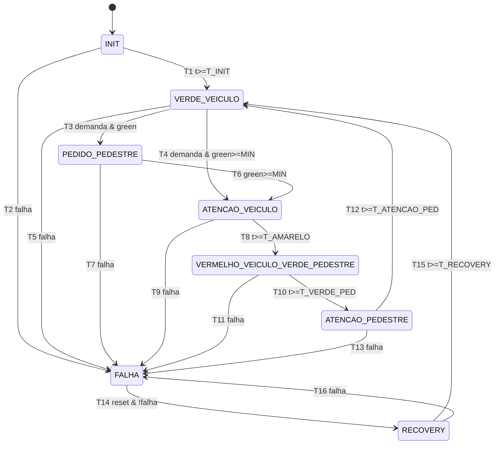

# Especificação da FSM — Semáforo com travessia de pedestres (PTT7)

Documento de especificação (OE1). A tabela `transition_table.csv` é a **especificação comum** usada
por três artefatos: o núcleo em C (`core/fsm_core.c`), o modelo Z3 (`verification/z3/fsm_model.hpp`)
e os harnesses ESBMC (`verification/esbmc/`). Qualquer mudança deve ser feita nos três e registrada
no commit.

## 1. Entradas, variáveis internas e saídas

| Símbolo | Tipo | Origem no firmware | Significado |
|---|---|---|---|
| `req1`, `req2` | evento | ISR dos botões de pedestre (GPIO 18/19) | demanda de travessia |
| `sig1_ok`, `sig2_ok` | nível | supervisão da linha dos botões (GPIO 22/23 com jumper ao GND) | integridade do sinal do botão |
| `reset` | evento | ISR do botão de reset (GPIO 21) | rearme após falha |
| `dt_ms` | inteiro | `esp_timer_get_time()` entre dois passos | tempo decorrido |
| `elapsed` | interno | — | tempo no estado atual (saturado em 60 000 ms) |
| `green` | interno | — | tempo acumulado de verde veicular em VV+PP |
| `pending` | interno | — | demanda memorizada (latch) |

**Falha** (`falha`) = `!sig1_ok || !sig2_ok || dt_ms > DT_MAX` (DT_MAX = 200 ms).
**Demanda** = `pending` após memorizar `req1 || req2` do passo atual.

Temporizações (ms, `core/fsm_config.h`): T_INIT = 2000 · T_VERDE_MIN = 8000 · T_AMARELO = 3000 ·
T_VERDE_PED = 6000 · T_ATENCAO_PED = 3000 · T_RECOVERY = 3000 · pisca = 500 ms por meia-onda.

## 2. Estados e saídas

| Estado | Veículo | Pedestre |
|---|---|---|
| INIT | vermelho | vermelho |
| VERDE_VEICULO (VV) | verde | vermelho |
| PEDIDO_PEDESTRE (PP) | verde | vermelho |
| ATENCAO_VEICULO (AV) | amarelo | vermelho |
| VERMELHO_VEICULO_VERDE_PEDESTRE (VP) | vermelho | verde |
| ATENCAO_PEDESTRE (AP) | vermelho | vermelho piscante |
| FALHA | amarelo piscante | apagado |
| RECOVERY | vermelho | vermelho |

## 3. Diagrama

Em todos os estados, se nenhuma guarda é satisfeita, a FSM permanece no estado (laço implícito).
Estado fora do domínio → FALHA (transição defensiva, fora das 16 especificadas).

## 4. Propriedades

| Id | Tipo | Enunciado | Camada Z3 | Camada ESBMC |
|---|---|---|---|---|
| P1 | alcançabilidade | os 8 estados são alcançáveis a partir de INIT | BMC existencial (SAT = caminho) | `harness_reach.c` (assert negado → contraexemplo = caminho) |
| P2 | ausência de deadlock | para todo estado válido e toda entrada admissível o próximo estado é definido e válido; de todo estado existe caminho de volta a VERDE_VEICULO | prova 1-passo (UNSAT) + BMC existencial | `harness_step.c` (todas as entradas) |
| P3 | segurança | nunca verde veicular (ou amarelo) junto com verde de pedestre; o verde de pedestre só existe em VP | prova sobre todos os estados (UNSAT) | `harness_step.c` + `harness_bmc.c` |
| P3b | segurança | o verde veicular só termina (sem falha) após `green >= T_VERDE_MIN` | prova 1-passo | `harness_step.c` |
| P4 | segurança | se a entrada viola as premissas (falha), o próximo estado é FALHA (exceto se já em FALHA, onde permanece) | prova 1-passo | `harness_step.c` |
| P5 | convergência | com falha persistente, FALHA é alcançado em ≤ 1 passo e não é abandonado enquanto a falha persistir | BMC k passos | `harness_bmc.c` |
| P6 | segurança | não há transição direta FALHA → VP; de FALHA só se sai para RECOVERY | prova 1-passo | `harness_step.c` |

As provas "1-passo" partem de um **contexto arbitrário válido** (qualquer estado, temporizadores e
latch no domínio) e qualquer entrada; como o domínio válido é preservado (também verificado),
elas valem para todas as execuções (argumento indutivo). Resultados de BMC valem apenas até o
horizonte `k` informado.
